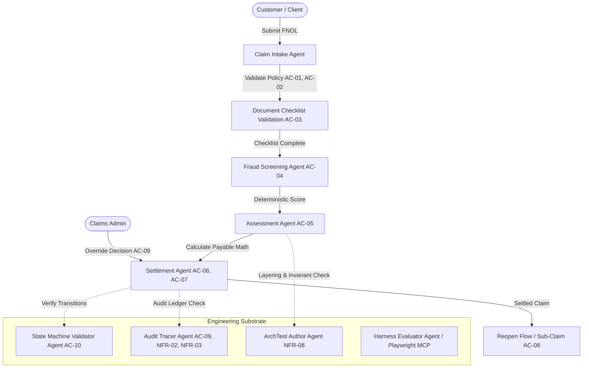

# AGENTS.md — Agent Registry & Architecture Index

This document acts strictly as a **Table of Contents and Index** for all autonomous Claude Code agents configured within the ClaimFlow project substrate (`.claude/agents/`).

---

## 1. Core Harness Foundation Agents

Base orchestration and quality engineering agents provided by the Claude Harness Engine framework:

| Agent | Definition File | Model | Primary Responsibilities |
|---|---|---|---|
| **Planner** | [`.claude/agents/planner.md`](file:///.claude/agents/planner.md) | Opus | Requirements expansion, BRD decomposition, feature dependency graphs, component mapping. |
| **Generator** | [`.claude/agents/generator.md`](file:///.claude/agents/generator.md) | Sonnet | Implementation execution, code & unit test generation, spawning focused worker agent teams. |
| **Evaluator** | [`.claude/agents/evaluator.md`](file:///.claude/agents/evaluator.md) | Opus | Objective evaluation gatekeeper, sprint contract verification, Playwright E2E & API test execution. |
| **Design Critic** | [`.claude/agents/design-critic.md`](file:///.claude/agents/design-critic.md) | Opus | Adversarial GAN UI review, visual polish scoring across four weighted UX dimensions. |
| **Security Reviewer** | [`.claude/agents/security-reviewer.md`](file:///.claude/agents/security-reviewer.md) | Sonnet | OWASP Top 10 vulnerability auditing, input sanitization, PII leak detection, RBAC boundaries. |
| **Test Engineer** | [`.claude/agents/test-engineer.md`](file:///.claude/agents/test-engineer.md) | Sonnet | Test plan generation, edge-case coverage expansion, Playwright browser test scripting. |
| **UI Designer** | [`.claude/agents/ui-designer.md`](file:///.claude/agents/ui-designer.md) | Sonnet | Component mockups, accessible responsive layout authoring, design tokens. |

---

## 2. ClaimFlow Domain Agents

Domain-specific agents customized for insurance claims operations (BC-AINE-005):

| Agent | Definition File | Model | Scope & Key Criteria |
|---|---|---|---|
| **Claim Intake Agent** | [`.claude/agents/claim-intake-agent.md`](file:///.claude/agents/claim-intake-agent.md) | Sonnet | First Notice of Loss (FNOL) intake validation, policy active date validation (`PolicyNotActiveException`), and document checklist initialization. Covers **AC-01**, **AC-02**, **AC-03**. |
| **Fraud Screening Agent** | [`.claude/agents/fraud-screening-agent.md`](file:///.claude/agents/fraud-screening-agent.md) | Sonnet | Deterministic rule-based fraud scoring, policy version threshold comparison, flag creation, and append-only scoring logs. Covers **AC-04**, **NFR-02**. |
| **Assessment Agent** | [`.claude/agents/assessment-agent.md`](file:///.claude/agents/assessment-agent.md) | Sonnet | Financial assessment calculation (`payable_amount = min(claim_amount, sum_insured) - deductibles - co_pay`), invariant enforcement (`payable_amount >= 0`), fixed-point math (`BigDecimal`). Covers **AC-05**, **NFR-01**. |
| **Settlement Agent** | [`.claude/agents/settlement-agent.md`](file:///.claude/agents/settlement-agent.md) | Sonnet | Adjudication decision generation (`AUTO_APPROVE`, `MANUAL_REVIEW`, `REJECT`), immutable payout record creation, stubbed disbursement execution, and reopen sub-claim management. Covers **AC-06**, **AC-07**, **AC-08**, **NFR-02**. |

---

## 3. ClaimFlow Technical & Quality Gate Agents

Engineering substrate agents ensuring architectural purity, state machine integrity, and audit compliance:

| Agent | Definition File | Model | Scope & Key Criteria |
|---|---|---|---|
| **State Machine Validator Agent** | [`.claude/agents/state-machine-validator-agent.md`](file:///.claude/agents/state-machine-validator-agent.md) | Sonnet | Validates strict claim lifecycle transitions (`FILED` → `UNDER_REVIEW` → `APPROVED`/`REJECTED` → `SETTLED` → `REOPENED`) and verifies `InvalidClaimStateException` on illegal transitions. Covers **AC-10**. |
| **Audit Tracer Agent** | [`.claude/agents/audit-tracer-agent.md`](file:///.claude/agents/audit-tracer-agent.md) | Sonnet | Verifies append-only storage guarantees (no update/delete), structured JSON logging with correlation IDs, PII redaction, and admin override audit trails. Covers **AC-09**, **NFR-02**, **NFR-03**, **NFR-04**, **NFR-06**. |
| **ArchTest Author Agent** | [`.claude/agents/archtest-author-agent.md`](file:///.claude/agents/archtest-author-agent.md) | Sonnet | Authors automated structural architecture tests, enforcing layer separation (`controllers` → `services` → `repositories` → `domain`), immutability rules, and domain model isolation. Covers **NFR-08**. |

---

## 4. Agent Collaboration & Workflow Graph

---

## 5. Agent Invocation & Substrate Command Mapping

| Custom Command | Invoked Agents | Output Artifacts |
|---|---|---|
| `/claude:verify-ac` | `evaluator`, `state-machine-validator-agent`, `archtest-author-agent` | `specs/reviews/ac-verification-report.md` |
| `/claude:assess-claim` | `assessment-agent` | Evaluated assessment computation & invariant report |
| `/claude:validate-state-machine` | `state-machine-validator-agent` | State transition verification matrix |
| `/claude:audit-trace` | `audit-tracer-agent` | Immutability and PII redaction compliance log |
