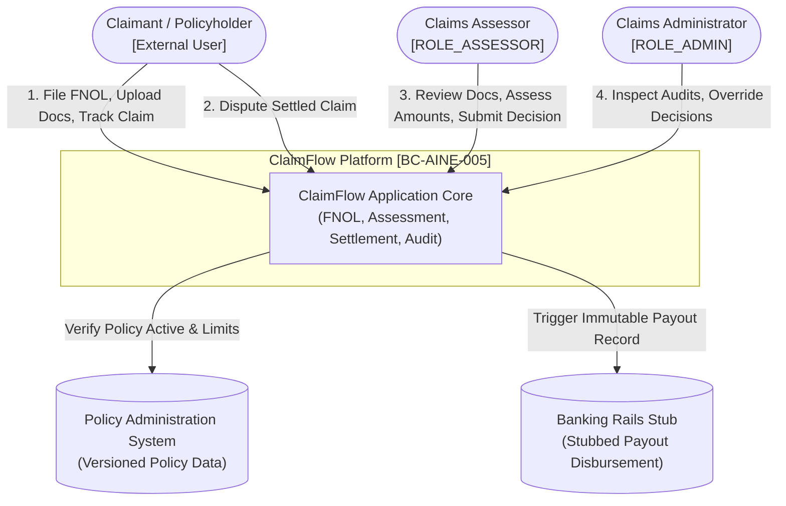
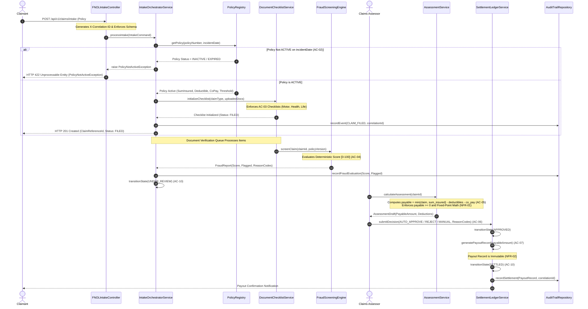

# Architecture Specification: ClaimFlow Platform
## Document Version: 1.0.0 | Domain: Insurance Claims Operations (BC-AINE-005)

---

## 1. Architectural Overview & Design Principles

**ClaimFlow** is architected according to **Clean Architecture** and **Domain-Driven Design (DDD)** principles, guaranteeing strict separation of concerns, isolation of domain invariants from infrastructure, and deterministic business logic execution.

### Architectural Tenets
1. **Domain Isolation:** The core domain logic (`src/domain/`) is pure and dependency-free. It has zero knowledge of databases, web frameworks, or external APIs.
2. **Fixed-Point Financial Math (NFR-01):** Floating-point numbers are prohibited in all financial calculation paths. All monetary figures (`claim_amount`, `sum_insured`, `deductibles`, `co_pay`, `payable_amount`, `payout_amount`) utilize fixed-point representations (`BigDecimal` in Java, `Decimal` in Python, or integer cents/micro-units in TypeScript).
3. **Append-Only Immutability (NFR-02):** Claims, assessments, fraud evaluations, decision audits, and settlements are immutable ledgers. State transitions append new state snapshot records rather than mutating existing rows. Hard `DELETE` operations are completely barred.
4. **Zero-PII Telemetry (NFR-03):** PII scrubbing filters intercept all application logging. Sensitive details (diagnoses, medical records, FIR narratives, bank account identifiers) are replaced with deterministic hashes or masked tokens before log serialization.
5. **Role-Based Controller Boundaries (NFR-04):** Web endpoints enforce strict authentication and authorization boundaries at the controller boundary. The `ROLE_ASSESSOR` and `ROLE_ADMIN` authority levels are isolated to separate route handlers.
6. **Structured Observability (NFR-06, NFR-07):** All requests generate an MDC-backed `correlation_id` propagated through services and written to structured JSON logs. A dedicated `/health` endpoint checks database connectivity and returns HTTP 200 in less than 1.0 second.
7. **Automated Architectural Enforcement (NFR-08):** Invariants and package layering dependencies are verified by automated architectural linting/test runners (`ArchUnit`, `dependency-cruiser`).

---

## 2. System Context & C4 Architectural Diagrams

### 2.1 C4 Level 1: System Context Diagram



---

### 2.2 C4 Level 2: Container & Layered Component Architecture

```mermaid
flowchart LR
    subgraph ClientTier ["Presentation & Client Tier"]
        WebUI["Responsive Web UI<br>(Customer Portal, Assessor Workbench, Admin Dashboard)"]
    end

    subgraph ControllerLayer ["Controllers Layer (src/controllers/)"]
        IntakeCtrl["FNOLIntakeController"]
        DocCtrl["DocumentVerificationController"]
        AssessCtrl["AssessmentController (ROLE_ASSESSOR)"]
        AdminCtrl["AdminOverrideController (ROLE_ADMIN)"]
        HealthCtrl["HealthCheckController (/health)"]
    end

    subgraph ServiceLayer ["Application Services Layer (src/services/)"]
        IntakeSvc["IntakeOrchestratorService"]
        DocSvc["DocumentChecklistService"]
        FraudSvc["DeterministicFraudScreeningService"]
        AssessSvc["AssessmentCalculationService"]
        SettleSvc["SettlementLedgerService"]
        AuditSvc["AuditTrailService"]
    end

    subgraph DomainLayer ["Core Domain Layer (src/domain/)"]
        ClaimEntity["Claim Aggregate Root"]
        PolicyVO["Policy & PolicyVersion VOs"]
        MoneyVO["FixedPointMoney Value Object"]
        StateMachine["ClaimStateMachine (AC-10)"]
        FraudRules["FraudScoringRules (AC-04)"]
        AssessmentRules["AssessmentCalculator (AC-05)"]
    end

    subgraph PersistenceLayer ["Repositories & Storage Layer (src/repositories/)"]
        ClaimRepo["ClaimRepository (Append-Only)"]
        DocRepo["DocumentRepository"]
        FraudRepo["FraudReportRepository"]
        PayoutRepo["PayoutLedgerRepository (Immutable)"]
        AuditRepo["AuditLogRepository (Append-Only)"]
    end

    WebUI -->|HTTP REST + CorrelationID| ControllerLayer
    ControllerLayer -->|DTOs / Commands| ServiceLayer
    ServiceLayer -->|Domain Events & Invariants| DomainLayer
    ServiceLayer -->|Persist Entities| PersistenceLayer
```



---

## 3. End-to-End Sequence Diagram: FNOL to Settlement Flow



---

## 4. Layered Directory Structure & Responsibilities

The codebase conforms strictly to the following 4-tier Clean Architecture layout:

```
src/
├── domain/                      <-- Core Business Logic & Invariants
│   ├── models/                  <-- Claim, Policy, Document, Assessment, Payout entities
│   ├── rules/                   <-- DocumentChecklistRule, FraudScoringRule, AssessmentRule
│   ├── state/                   <-- ClaimStateMachine, ClaimStateEnum, StateTransitions
│   ├── exceptions/              <-- PolicyNotActiveException, InvalidClaimStateException
│   └── valueobjects/            <-- FixedPointMoney, PolicyNumber, ClaimType, ReasonCode
├── controllers/                 <-- HTTP API & Security Layer
│   ├── filters/                 <-- CorrelationIdFilter, PiiRedactionLogFilter
│   ├── security/                <-- RBAC Guards (ROLE_ASSESSOR, ROLE_ADMIN)
│   ├── requests/                <-- Validated Request DTOs
│   ├── responses/               <-- Sanitized Response DTOs
│   └── *.controller.*           <-- REST Endpoints
├── services/                    <-- Application Orchestration & Use Cases
│   ├── commands/                <-- Command Objects (FileClaim, VerifyDoc, SubmitDecision)
│   ├── dtos/                    <-- Service Transfer Payloads
│   └── *.service.*              <-- Transaction-bounded workflow services
└── repositories/                <-- Persistence & Ledger Storage
    ├── entities/                <-- DB Schemas / Tables
    ├── ledgers/                 <-- Append-only audit and payout writers
    └── *.repository.*           <-- Repository interfaces & implementations
```

---

## 5. Append-Only Data Architecture & Ledger Design (NFR-02)

To comply with regulatory insurance audit mandates, ClaimFlow implements an **Event-Sourced Append-Only Ledger Pattern**:

| Table / Entity | Permitted SQL Operations | Immutability Safeguards |
|---|---|---|
| `claims` | `INSERT`, `SELECT` | State transitions are stored as new records with sequential sequence numbers. |
| `fraud_evaluations` | `INSERT`, `SELECT` | Scores, evaluated rules, and threshold versions are written once and never updated. |
| `assessments` | `INSERT`, `SELECT` | Each calculation revision is appended with an incrementing assessment version ID. |
| `payout_records` | `INSERT`, `SELECT` | Payout records are immutable once written; subsequent reversals or disputes append new offsetting records. |
| `audit_logs` | `INSERT`, `SELECT` | Read-only ledger containing actor, role, correlation ID, timestamp, and action delta. |

---

## 6. Security, PII Redaction & Role Boundaries (NFR-03, NFR-04)

### 6.1 Role Segregation Matrix
- **`ROLE_CUSTOMER` / Anonymous:** Can only POST new FNOL intakes (`/api/v1/claims/intake`) and GET claim status for their verified claim reference ID (`/api/v1/claims/{id}/status`).
- **`ROLE_ASSESSOR`:** Can inspect pending documents, view fraud evaluation flags, trigger financial assessment calculators, and submit standard decisions (`/api/v1/assessor/**`).
- **`ROLE_ADMIN`:** Distinct administrative role. Only admins can access override endpoints (`/api/v1/admin/claims/{id}/override`), access security settings, and query full raw audit logs.

### 6.2 Zero-PII Logging Implementation
A logging interceptor sanitizes all log outputs using regex pattern substitution before emission to stdout:
```
Original: "Claimant John Doe (SSN: 000-12-3456, IBAN: GB29NWBK60161331926819) filed medical claim for leukemia."
Sanitized: "Claimant [REDACTED_NAME] (SSN: [REDACTED_SSN], IBAN: [REDACTED_IBAN]) filed medical claim for [REDACTED_DIAGNOSIS]."
```

---

## 7. Health Check Specification (NFR-07)

Endpoint: `GET /health`
- **Response Time Guarantee:** ≤ 1,000 milliseconds from cold startup.
- **Payload Schema:**
```json
{
  "status": "UP",
  "timestamp": "2026-10-04T12:00:00Z",
  "checks": {
    "database": { "status": "UP", "responseTimeMs": 12 },
    "state_machine": { "status": "UP" },
    "ledger_storage": { "status": "UP" }
  },
  "version": "1.0.0"
}
```
