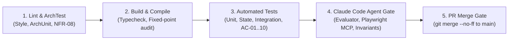

# CI/CD Pipeline & Claude Code Agent Integration
## Document Version: 1.0.0 | Domain: Insurance Claims Operations (BC-AINE-005)

---

## 1. Overview & Pipeline Philosophy

ClaimFlow enforces an **AI-Native Continuous Integration & Deployment (CI/CD)** pipeline. In accordance with the **PR-Only Merge Rule**, direct commits and pushes to the `main` branch are strictly prohibited. Every change must originate in a feature branch, undergo automated build and test passes, receive automated evaluation by the Claude Code Agent Action, and be merged using `--no-ff` (non-fast-forward) to preserve a permanent audit history.

---

## 2. Pipeline Stages

The CI pipeline consists of 5 sequential stages:



### Stage Details:
1. **Lint & ArchTest:**
   - Enforces package layering rules (`controllers` → `services` → `repositories` → `domain`).
   - Verifies **NFR-01** (zero float/double types in financial packages).
   - Scans for unmasked PII in log configurations (**NFR-03**).
2. **Build & Compile:**
   - Performs clean compilation and packaging.
   - Validates that database migrations are append-only (**NFR-05**).
3. **Automated Tests:**
   - Executes full unit and state machine test suites.
   - Asserts every test is tagged with its canonical AC identifier (`@tag("AC-NN")`).
   - Generates coverage report (`coverage.xml` / `lcov.info`) asserting coverage ≥ 80%.
4. **Claude Code Agent Gate:**
   - Boots application container in background.
   - Evaluates `/health` endpoint response time (< 1,000ms per **NFR-07**).
   - Connects Playwright MCP to execute browser user journeys.
   - Evaluator agent checks sprint contract and outputs `specs/reviews/ac-verification-report.md`.
5. **PR Merge Gate:**
   - Verifies PR-driven merge trail.
   - Merges with `git merge --no-ff` to preserve PR history.

---

## 3. Git Workflow & Merge Trace

```bash
# Feature branch creation
git checkout -b feature/ac-05-assessment-calculator

# Agent commits following TDD red-green-refactor loop
git commit -m "test(domain): author failing unit test for AC-05 payable math"
git commit -m "feat(domain): implement fixed-point assessment calculation [AC-05]"
git commit -m "refactor(domain): extract FixedPointMoney value object [NFR-01]"

# Non-fast-forward merge preserving branch history
git checkout main
git merge --no-ff feature/ac-05-assessment-calculator -m "Merge PR #12: Feature AC-05 Assessment Calculation"
```
