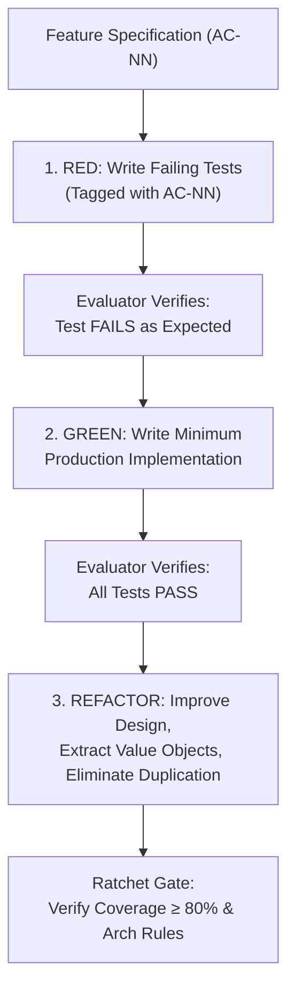

# Test-Driven Development (TDD) Discipline & Methodology
## Document Version: 1.0.0 | Domain: Insurance Claims Operations (BC-AINE-005)

---

## 1. AI-Native TDD Philosophy & The Red-Green-Refactor Loop

In ClaimFlow's AI-native engineering model, Test-Driven Development is not merely a developer convention; it is an **enforced architectural guardrail**. AI agents are prone to hallucinating edge cases, drifting from business specifications, or writing untestable code when generating logic before tests.

The **Claude Harness Engine** enforces a rigorous **Red-Green-Refactor** loop between the `generator` and `evaluator` agents:



### The Three Phases
1. **Phase 1 — RED (Test First):**
   - The agent writes unit and domain tests targeting the specific Acceptance Criteria (`AC-01` through `AC-10`).
   - The test must be executed and confirmed to fail with a clear assertion failure (not a compilation or syntax error).
2. **Phase 2 — GREEN (Minimum Code):**
   - The agent writes the simplest, most direct production code required to satisfy the failing assertions.
   - Speculative abstractions, unused methods, and unrequested features are strictly barred.
3. **Phase 3 — REFACTOR (Quality Enhancement):**
   - Code is cleaned, duplicated logic is extracted into shared domain rules, and value objects are hardened.
   - Tests are rerun to ensure zero regressions occur during refactoring.

---

## 2. Test Taxonomy & Coverage Mandates

| Test Category | Target Directory | Primary Focus & Verification Scope | Mandatory Tags |
|---|---|---|---|
| **Domain Unit Tests** | `tests/unit/domain/` | Pure business rules, formula calculations, fixed-point math, boundary conditions. | `@tag("AC-05")`, `@tag("NFR-01")` |
| **State Machine Tests** | `tests/unit/state/` | Exhaustive valid and invalid lifecycle transitions. | `@tag("AC-10")` |
| **Service Integration Tests** | `tests/integration/` | Transaction boundaries, append-only repository writes, orchestrations. | `@tag("AC-01")`, `@tag("AC-02")` |
| **API Controller Tests** | `tests/api/` | Authentication boundaries, role separation (`ROLE_ASSESSOR` vs `ROLE_ADMIN`), PII masking. | `@tag("NFR-03")`, `@tag("NFR-04")` |
| **Architecture Tests** | `tests/architecture/` | Layering enforcement, package isolation, domain immutability (`ArchUnit`). | `@tag("NFR-08")` |
| **Playwright UI E2E** | `tests/e2e/` | Visual user journeys: FNOL submission, assessor workbench, admin override. | `@tag("E2E")`, `@tag("UI")` |

---

## 3. Acceptance Criteria Tagging Convention

Every test class and test method in the test suite must explicitly declare its corresponding Acceptance Criterion using standardized tagging:
- `// [AC-01] Customer FNOL filing`
- `// [AC-02] Policy inactive rejection`
- `// [AC-03] Document checklist validation`
- `// [AC-04] Deterministic fraud scoring`
- `// [AC-05] Assessment calculation math & invariant`
- `// [AC-06] Adjudication decision codes`
- `// [AC-07] Immutable payout record`
- `// [AC-08] Dispute & sub-claim reopening`
- `// [AC-09] Audited admin override`
- `// [AC-10] State machine lifecycle transitions`

---

## 4. Worked Example: TDD Cycle for Assessment Calculation (AC-05, NFR-01)

### Specification Reference: AC-05 & NFR-01
- **Formula:** `payable_amount = min(claim_amount, sum_insured) - deductibles - co_pay`
- **Invariant:** `payable_amount >= 0` must hold in all cases (deductions exceeding claim amount clamp to zero).
- **NFR-01:** Computations must use fixed-point arithmetic (`BigDecimal`), never floating point.

---

### Step 1: RED Phase — Author Failing Test Suite

The agent writes comprehensive test assertions covering standard payout, sum insured capping, and deductible overflow clamping:

```markdown
// Test Specification: AssessmentCalculatorTest
// Target: src/domain/rules/AssessmentCalculator

Scenario 1: Standard Assessment Calculation
- Given: Claim Amount = $5,000.00, Sum Insured = $10,000.00, Deductible = $500.00, CoPay = $250.00
- When: Assessment is computed
- Then: Payable Amount must equal $4,250.00

Scenario 2: Sum Insured Capping
- Given: Claim Amount = $15,000.00, Sum Insured = $10,000.00, Deductible = $1,000.00, CoPay = $0.00
- When: Assessment is computed
- Then: Payable Amount must equal $9,000.00 (min capped at Sum Insured)

Scenario 3: Deductible Exceeds Claim (Invariant payable_amount >= 0)
- Given: Claim Amount = $800.00, Sum Insured = $5,000.00, Deductible = $1,000.00, CoPay = $200.00
- When: Assessment is computed
- Then: Payable Amount must be clamped to $0.00 (NOT -$400.00)

Scenario 4: Fixed-Point Currency Precision (NFR-01)
- Given: Fractional Cent Inputs ($1,234.56 - $0.10)
- When: Assessment is computed
- Then: Exact scale of 2 decimal places preserved without IEEE-754 binary floating drift
```

**Evaluator Execution:** The test suite is executed against an empty or stubbed calculator.
*Result:* `AssertionError: Expected $4,250.00 but received null` -> **STATUS: RED CONFIRMED**.

---

### Step 2: GREEN Phase — Minimum Passing Implementation

The agent writes the pure calculation logic utilizing fixed-point arithmetic and explicit non-negative clamping:

```markdown
// Target: AssessmentCalculator Logic
1. Validate inputs are non-null and have scale <= 2.
2. effective_claim = claim_amount.min(sum_insured)
3. gross_deductions = deductibles.add(co_pay)
4. net_payable = effective_claim.subtract(gross_deductions)
5. final_payable = net_payable.max(BigDecimal.ZERO)
6. return AssessmentResult(effective_claim, deductibles, co_pay, final_payable)
```

**Evaluator Execution:** The test suite is rerun.
*Result:* All 4 scenarios pass without error. -> **STATUS: GREEN CONFIRMED**.

---

### Step 3: REFACTOR Phase — Quality Enhancement

During the refactor phase, the agent isolates `FixedPointMoney` as an immutable value object, adds immutability guarantees, and ensures formatting consistency across currency outputs.

```markdown
Refactor Actions:
- Wrap raw BigDecimal primitives into an immutable `FixedPointMoney` Value Object.
- Enforce rounding mode `RoundingMode.HALF_EVEN` (Banker's rounding) on any intermediate currency transformations.
- Ensure all returned assessment records are declared immutable.
```

**Evaluator Execution:** Full test regression suite executed.
*Result:* 100% tests pass, zero regressions, 100% branch coverage achieved. -> **STATUS: RATCHET LOCKED**.
