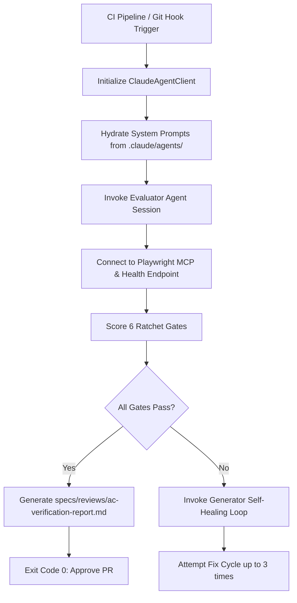

# scripts/README.md — Programmatic Claude Agent SDK Architecture & Workflow

This document specifies the design, invocation contracts, and lifecycle patterns for programmatic usage of the **Claude Agent SDK** within the ClaimFlow engineering pipeline.

---

## 1. Overview & Purpose

In addition to interactive slash commands and IDE interactions, ClaimFlow utilizes programmatic Claude Agent SDK integrations to drive automated continuous integration (CI), headless evaluation gates, and autonomous fix loops.

The programmatic SDK enables:
1. **Automated Evaluator Orchestration:** Running the `evaluator` agent headlessly inside CI runners against running Docker containers.
2. **Headless Quality Ratcheting:** Comparing test coverage and architecture invariants against baseline metrics without human intervention.
3. **Automated PR Review Gate:** Invoking `security-reviewer` and `archtest-author-agent` to certify pull requests before non-fast-forward merge to `main`.

---

## 2. Programmatic SDK Workflow Architecture



---

## 3. SDK Invocation Contract & Parameter Specification

The headless runner communicates with the SDK via the following structured interface:

- **Agent Name:** `evaluator` (Opus) / `security-reviewer` (Sonnet)
- **Agent Substrate Root:** `.claude/`
- **Environment Variables:**
  - `ANTHROPIC_API_KEY`: Authentication secret for agent invocation.
  - `EVAL_BASE_URL`: Application container host (`http://localhost:3000`).
  - `PLAYWRIGHT_MCP_PORT`: Port binding for browser evaluation.
- **Output Artifacts:**
  - `specs/reviews/ac-verification-report.md`: Structured evaluation report.
  - `.claude/state/eval-scores.json`: Numeric scores across UI, API, and architectural invariants.

---

## 4. Autonomous Ratchet Decision Logic

```markdown
When the programmatic agent executes:
1. Probe GET /health (assert latency <= 1000ms and HTTP 200).
2. Execute Playwright browser verification flow:
   - File FNOL with Motor claim payload.
   - Verify document upload receipts.
   - Check status progression.
3. Execute API verification tests covering AC-01 through AC-10.
4. Verify architecture rules:
   - Ensure zero floating-point usages in src/domain/.
   - Ensure zero UPDATE/DELETE operations on payout ledgers.
5. If all checks PASS:
   - Write updated coverage baseline to .claude/state/coverage-baseline.txt.
   - Issue sign-off approval comment on the Git Pull Request.
```
