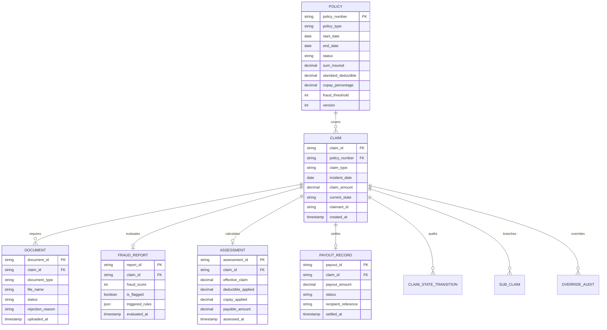

# Application Specification: ClaimFlow Platform
## Document Version: 1.0.0 | Domain: Insurance Claims Operations (BC-AINE-005)

---

## 1. System Vision & Architecture Scope

**ClaimFlow** is an enterprise claims processing platform built for **Horizon Insurance** to streamline claims intake, document inspection, fraud scoring, assessment calculation, adjudication, settlement disbursement, and dispute management across **Motor**, **Health**, and **Life** insurance policies.

### 1.1 Core Objectives
- Automate the end-to-end First Notice of Loss (FNOL) to settlement lifecycle.
- Eliminate manual errors in financial calculations through strict fixed-point arithmetic (`BigDecimal`) and mathematical invariants.
- Guarantee full auditability and regulatory compliance via append-only event recording and immutability safeguards.
- Enforce strict role segregation between claimant, assessor, and administrative personnel.

---

## 2. Global Acceptance Criteria Mapping (AC-01 through AC-10)

| AC ID | Feature Module | Summary Description | Primary Specification File |
|---|---|---|---|
| **AC-01** | FNOL Intake | Customer files FNOL with policy number, incident date, claim type, and supporting documents. | [`specs/intake_spec.md`](file:///specs/intake_spec.md) |
| **AC-02** | FNOL Intake | Intake rejected with `PolicyNotActiveException` if policy is not ACTIVE on incident date. | [`specs/intake_spec.md`](file:///specs/intake_spec.md) |
| **AC-03** | Document Verification | Checklist enforcement varies by claim type (Motor, Health, Life). | [`specs/document_verification_spec.md`](file:///specs/document_verification_spec.md) |
| **AC-04** | Fraud Screening | Deterministic fraud screening returns score [0–100]; flags claim if score > threshold. | [`specs/fraud_screening_spec.md`](file:///specs/fraud_screening_spec.md) |
| **AC-05** | Assessment | Computes `payable = min(claim, sum_insured) - deductibles - co_pay`; invariant `payable >= 0`. | [`specs/assessment_spec.md`](file:///specs/assessment_spec.md) |
| **AC-06** | Decision Engine | Adjudication returns `AUTO_APPROVE`, `MANUAL_REVIEW`, or `REJECT` with versioned reason codes. | [`specs/settlement_spec.md`](file:///specs/settlement_spec.md) |
| **AC-07** | Settlement | Settlement produces immutable payout record; `payout_amount` equals assessed amount. | [`specs/settlement_spec.md`](file:///specs/settlement_spec.md) |
| **AC-08** | Dispute / Reopen | Reopen creates linked sub-claim; original claim moves to `REOPENED` and remains queryable. | [`specs/reopen_spec.md`](file:///specs/reopen_spec.md) |
| **AC-09** | Admin Override | Admin overrides `AUTO_APPROVE` or `REJECT` with comment and reason code; audited with actor and timestamp. | [`specs/admin_override_spec.md`](file:///specs/admin_override_spec.md) |
| **AC-10** | State Machine | Enforces lifecycle: `FILED` → `UNDER_REVIEW` → `APPROVED`/`REJECTED` → `SETTLED` → `REOPENED`; invalid transitions raise `InvalidClaimStateException`. | [`specs/state_machine_spec.md`](file:///specs/state_machine_spec.md) |

---

## 3. Global Non-Functional Requirements Mapping (NFR-01 through NFR-08)

- **NFR-01 (Fixed-Point Financial Math):** All financial attributes (`claim_amount`, `sum_insured`, `deductibles`, `co_pay`, `payable_amount`, `payout_amount`) must be stored and computed using high-precision fixed-point numbers (`BigDecimal` with scale 2 and `HALF_EVEN` rounding). Floating-point values (`double`, `float`) are prohibited.
- **NFR-02 (Append-Only Ledger Architecture):** Claim records, fraud evaluations, assessments, audit trails, and settlement payouts are strictly append-only. No `UPDATE` or `DELETE` statements may execute against historical financial and lifecycle rows.
- **NFR-03 (PII Redaction):** Personally Identifiable Information (claimant national identifiers, names, medical diagnoses, FIR police narratives, bank details) must never be written to application logs, metrics, or telemetry.
- **NFR-04 (Role-Based Access Separation):** Security boundaries are enforced at the HTTP controller layer. Assessor permissions (`ROLE_ASSESSOR`) and administrator permissions (`ROLE_ADMIN`) are strictly segregated.
- **NFR-05 (Append-Only Database Migrations):** Schema evolutions are forward-only and append-only. Destructive modifications (dropping columns, dropping tables) are strictly disallowed.
- **NFR-06 (Structured JSON Logging & Correlation IDs):** All log entries must use structured JSON format containing a mandatory `correlation_id` header propagated throughout the execution context.
- **NFR-07 (Health Endpoint Performance):** The service health endpoint (`GET /health`) must return HTTP 200 within 1,000ms from cold start.
- **NFR-08 (Architecture Rules as Automated Tests):** Layering separation (`controllers` → `services` → `repositories` → `domain`) and core business invariants must be validated by automated architecture tests (`ArchUnit` / structural linters).

---

## 4. Master Domain Entities & Schema Dictionary

---

## 5. Architectural Quality Attributes & Boundaries

1. **Pure Domain Core:** Code under `src/domain/` contains zero framework annotations, zero database imports, and zero external I/O.
2. **Invariants as Preconditions:** Domain constructors and factories validate state integrity immediately upon instantiation.
3. **Spec-Is-Truth Compliance:** If an implementation drifts from any requirement in `specs/*`, the specification governs and the code must be regenerated.
