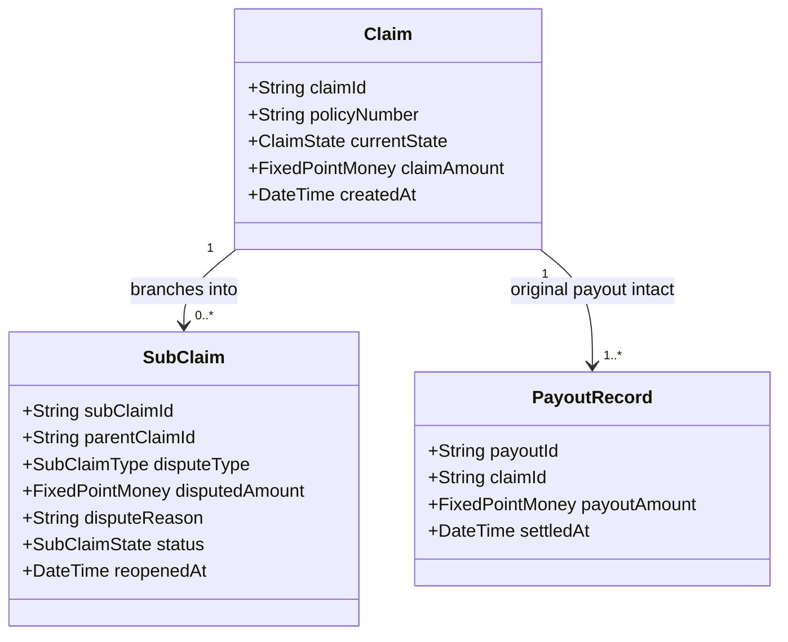

# Feature Specification: Dispute & Sub-Claim Reopening
## Feature ID: SPEC-06 | Domain: Insurance Claims Operations (BC-AINE-005)

---

## 1. Feature Description & Scope

The **Dispute & Sub-Claim Reopening** module provides claimants with a formal recourse mechanism to challenge or supplement settled claim outcomes. 

In conventional insurance architectures, reopening a settled claim often overwrites historical settlement amounts or mutates closed claim records, violating accounting integrity. ClaimFlow resolves this by enforcing a **Sub-Claim Branching Model**: when a dispute is raised against an already settled claim, the original claim moves to the `REOPENED` state while remaining fully immutable and queryable, and a distinct, linked **sub-claim** is spawned to handle the dispute.

---

## 2. Acceptance Criteria

### AC-08: Reopen Creates Linked Sub-Claim & Maintains Original Queryability
**Criterion Statement:** Reopen creates a new sub-claim linked to the original; original claim moves to `REOPENED` state and remains queryable.

- **Scenario 8.1: Valid Dispute on a Settled Claim**
  - **Given** an existing claim `"CLM-2026-00491"` in `SETTLED` state with an established payout of `$3,300.00`,
  - **When** the claimant or adjuster submits a dispute request with justification `"Supplemental invoice for hidden chassis damage"` and supplemental amount `$850.00`,
  - **Then** the original claim `"CLM-2026-00491"` transitions state from `SETTLED` to `REOPENED`,
  - **And** a new sub-claim record is created with a unique identifier (e.g., `"SUB-2026-00491-01"`),
  - **And** the sub-claim stores a foreign key reference `parentClaimId = "CLM-2026-00491"`,
  - **And** the original claim's payout history and previous assessment remain 100% queryable and unchanged,
  - **And** HTTP status `201 Created` is returned with both parent and sub-claim references.

- **Scenario 8.2: Attempted Reopen on Non-Settled Claim**
  - **Given** a claim in `FILED`, `UNDER_REVIEW`, or `APPROVED` status,
  - **When** a user attempts to initiate a dispute/reopen action,
  - **Then** the request is rejected with `InvalidClaimStateException`,
  - **And** HTTP `400 Bad Request` or `409 Conflict` is returned,
  - **And** no sub-claim is created.

- **Scenario 8.3: Queryability of Historical Settled State**
  - **Given** a claim that has transitioned to `REOPENED`,
  - **When** an auditor or claimant queries `GET /api/v1/claims/CLM-2026-00491`,
  - **Then** the system returns full historical records: original claim amount, original assessment, original payout record of `$3,300.00`, and a list of active linked sub-claims.

---

## 3. Sub-Claim Data Model & Architecture



---

## 4. API Contract Specification

### 4.1 Endpoint: `POST /api/v1/claims/{claimId}/reopen`
- **Request Body:**
```json
{
  "disputeReason": "Supplemental garage bill discovered for concealed internal transmission damage.",
  "supplementalAmount": 850.00,
  "disputeCategory": "SUPPLEMENTAL_DAMAGE",
  "supportingDocuments": [
    {
      "documentType": "REPAIR_INVOICE",
      "fileName": "supplemental_invoice_transmission.pdf",
      "fileContentStub": "data:application/pdf;base64,stubbed_payload=="
    }
  ]
}
```

- **Response Body (`201 Created`):**
```json
{
  "subClaimId": "SUB-2026-00491-01",
  "parentClaimId": "CLM-2026-00491",
  "parentClaimStatus": "REOPENED",
  "subClaimStatus": "UNDER_REVIEW",
  "disputedAmount": 850.00,
  "disputeReason": "Supplemental garage bill discovered for concealed internal transmission damage.",
  "reopenedAt": "2026-10-04T12:25:00Z"
}
```

---

## 5. Non-Functional Criteria & Guardrails

- **NFR-02:** The original claim row and previous `payout_records` are never updated or deleted. Reopening creates an immutable `claim_state_transitions` audit entry (`SETTLED` → `REOPENED`) and inserts a new `sub_claims` row.
- **NFR-04:** Reopening can be initiated by `ROLE_CUSTOMER` (self-service dispute) or `ROLE_ASSESSOR` / `ROLE_ADMIN`.
- **NFR-08:** Automated test verifies that original settlement payout balance is identical before and after a reopen action.
