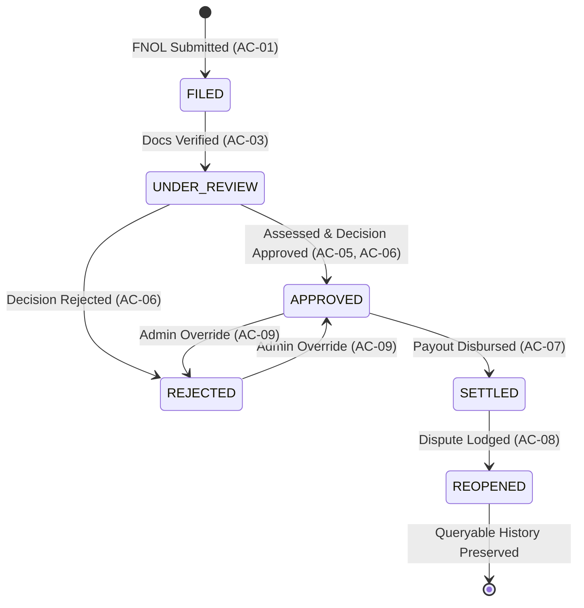

# Feature Specification: Claim Lifecycle State Machine & Transition Rules
## Feature ID: SPEC-08 | Domain: Insurance Claims Operations (BC-AINE-005)

---

## 1. Feature Description & Scope

The **Claim Lifecycle State Machine** is the central orchestrator of claim status and progression within ClaimFlow. It formalizes and enforces the strict business process lifecycle through which every insurance claim must traverse.

By establishing an immutable, deterministic finite state machine, ClaimFlow guarantees that claims cannot jump lifecycle phases (e.g., direct approval without review), cannot regress inappropriately, and cannot undergo forbidden modifications once settled. Any attempt to execute an illegal state transition immediately aborts the operation and raises `InvalidClaimStateException`.

---

## 2. Acceptance Criteria

### AC-10: Enforced Lifecycle Transitions & Invalid Transition Exception
**Criterion Statement:** Claim state transitions `FILED` → `UNDER_REVIEW` → `APPROVED` / `REJECTED` → `SETTLED` → `REOPENED` are enforced; invalid transitions raise `InvalidClaimStateException`.

- **Scenario 10.1: Happy Path End-to-End State Progression**
  - **Given** an initial FNOL submission,
  - **When** the claim is created,
  - **Then** state is `FILED`.
  - **When** document checklist requirements are verified,
  - **Then** state transitions to `UNDER_REVIEW`.
  - **When** assessment is finalized and decisioning approves the claim,
  - **Then** state transitions to `APPROVED`.
  - **When** immutable payout is generated and disbursed,
  - **Then** state transitions to `SETTLED`.
  - **When** a dispute is lodged against the settlement,
  - **Then** state transitions to `REOPENED` (and a sub-claim is branched).

- **Scenario 10.2: Valid Transition to REJECTED**
  - **Given** a claim in `UNDER_REVIEW`,
  - **When** decisioning determines policy exclusion or fraud,
  - **Then** state transitions to `REJECTED`.

- **Scenario 10.3: Illegal Skip Transition (FILED Directly to APPROVED)**
  - **Given** a claim currently in `FILED` status,
  - **When** an API call or service attempts to force transition to `APPROVED`,
  - **Then** the state machine blocks the operation,
  - **And** immediately raises `InvalidClaimStateException` with message `"Cannot transition claim CLM-101 from FILED to APPROVED. Valid target states: [UNDER_REVIEW]"`,
  - **And** the database transaction rolls back, leaving state unchanged as `FILED`.

- **Scenario 10.4: Illegal Regression (SETTLED Back to UNDER_REVIEW)**
  - **Given** a claim in `SETTLED` status,
  - **When** an attempt is made to transition back to `UNDER_REVIEW`,
  - **Then** `InvalidClaimStateException` is raised,
  - **And** the system indicates that settled claims can only transition to `REOPENED` via the formal dispute workflow.

- **Scenario 10.5: Attempted Transition from Terminal REJECTED State**
  - **Given** a claim in `REJECTED` status,
  - **When** an attempt is made to transition to `SETTLED`,
  - **Then** `InvalidClaimStateException` is raised,
  - **And** the transition is blocked.

---

## 3. Finite State Machine Transition Matrix



### Transition Authority Table:

| Current State | Target State | Triggering Business Event | Allowed Actor / Role |
|---|---|---|---|
| *None* | `FILED` | Successful FNOL Submission (AC-01, AC-02) | Customer / System |
| `FILED` | `UNDER_REVIEW` | Mandatory Document Checklist Verified (AC-03) | System / Assessor |
| `UNDER_REVIEW` | `APPROVED` | Assessment Complete & Approval Decision (AC-06) | Assessor / System |
| `UNDER_REVIEW` | `REJECTED` | Policy Exclusion / Rejection Decision (AC-06) | Assessor / System |
| `APPROVED` | `SETTLED` | Immutable Payout Record Created (AC-07) | System Payout Engine |
| `APPROVED` | `REJECTED` | Admin Decision Override (AC-09) | `ROLE_ADMIN` |
| `REJECTED` | `APPROVED` | Admin Decision Override (AC-09) | `ROLE_ADMIN` |
| `SETTLED` | `REOPENED` | Dispute Registered on Settled Claim (AC-08) | Customer / Assessor |

*Any state transition pair not explicitly listed above is strictly FORBIDDEN.*

---

## 4. Exception Specification: `InvalidClaimStateException`

- **Class Name:** `com.horizon.claimflow.domain.exceptions.InvalidClaimStateException`
- **HTTP Status Code Mapping:** `409 Conflict` (or `422 Unprocessable Entity`)
- **Exception Attributes:**
  - `claimId` (String): Identifier of the affected claim.
  - `currentState` (ClaimState): Current lifecycle state at time of invocation.
  - `attemptedTargetState` (ClaimState): Requested illegal target state.
  - `allowedTargetStates` (List<ClaimState>): List of permitted transitions from current state.

- **JSON Error Payload:**
```json
{
  "error": "InvalidClaimStateException",
  "code": "ILLEGAL_STATE_TRANSITION",
  "message": "Illegal lifecycle transition: Cannot move claim CLM-2026-00491 from FILED to APPROVED. Permitted target states: [UNDER_REVIEW]",
  "claimId": "CLM-2026-00491",
  "currentState": "FILED",
  "attemptedTargetState": "APPROVED",
  "permittedTargetStates": ["UNDER_REVIEW"],
  "timestamp": "2026-10-04T12:30:00Z"
}
```

---

## 5. Non-Functional Criteria & Guardrails

- **NFR-02:** Every valid state transition appends a row to `claim_state_transitions` with `(claim_id, from_state, to_state, actor, transition_timestamp)`.
- **NFR-08:** Architecture test suite executes exhaustive $6 \times 6$ transition matrix test, asserting that exactly the 8 valid transition paths succeed and all other 28 paths throw `InvalidClaimStateException`.
