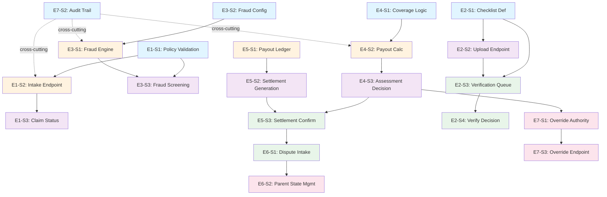

# Dependency Graph — ClaimFlow Stories

This document maps story dependencies across all epics, organized into parallel execution groups (A through E).

---

## Group A — Foundation Layer (No Dependencies)

Stories with no external dependencies. These can be developed in parallel.

| Story ID | Title | Layer | Status |
|----------|-------|-------|--------|
| E1-S1 | Policy Active Date Validation Rule | Backend / Service | Foundation |
| E2-S1 | Document Checklist Definition Per LOB | Backend / Config | Foundation |
| E3-S2 | Fraud Threshold Configuration Loader | Backend / Config | Foundation |
| E4-S1 | Coverage Assessment Logic | Backend / Service | Foundation |
| E7-S2 | Audit Trail Recording & Immutability Enforcement | Backend / Repository | Foundation |

**Notes:**
- E1-S1 establishes the policy active date rule used by E1-S2
- E2-S1 defines mandatory document checklists used by E2-S2, E2-S3, E2-S4
- E3-S2 loads fraud thresholds used by E3-S1
- E4-S1 establishes coverage assessment logic used by E4-S2
- E7-S2 is cross-cutting; audit trail is triggered by all state transitions

---

## Group B — Early Service & Persistence Layer

Stories depend on Group A. Can proceed once Group A is complete.

| Story ID | Title | Layer | Depends On |
|----------|-------|-------|-----------|
| E1-S2 | Claim Intake Endpoint (FNOL Filing) | Backend / API | E1-S1 |
| E3-S1 | Deterministic Fraud Rule Engine | Backend / Service | E3-S2 |
| E4-S2 | Payout Calculation with Financial Invariants | Backend / Service | E4-S1 |
| E5-S1 | Immutable Payout Ledger Repository | Backend / Repository | — |

**Notes:**
- E1-S2 calls E1-S1 validation at claim intake
- E3-S1 uses fraud thresholds from E3-S2
- E4-S2 extends coverage assessment from E4-S1
- E5-S1 is foundational persistence; no dependencies

---

## Group C — Mid-Pipeline API & Service Layer

Stories depend on Groups A and B. Can proceed once Group B is complete.

| Story ID | Title | Layer | Depends On |
|----------|-------|-------|-----------|
| E1-S3 | Claim Status Query Endpoint | Backend / API | E1-S2 |
| E2-S2 | Document Upload & Storage Endpoint | Backend / API | E2-S1 |
| E3-S3 | Fraud Screening & Routing Endpoint | Backend / API | E3-S1, E1-S2 |
| E4-S3 | Assessment Decision Submission Endpoint | Backend / API | E4-S2 |
| E5-S2 | Settlement Payout Generation Service | Backend / Service | E5-S1 |

**Notes:**
- E1-S3 queries claims created by E1-S2
- E2-S2 uses checklist rules from E2-S1; uploads are verified by E2-S3
- E3-S3 calls fraud engine from E3-S1; requires claims from E1-S2
- E4-S3 calls payout calculation from E4-S2
- E5-S2 uses ledger repository from E5-S1

---

## Group D — Document Verification & Settlement Finalization

Stories depend on Groups A, B, C. Can proceed once Group C is complete.

| Story ID | Title | Layer | Depends On |
|----------|-------|-------|-----------|
| E2-S3 | Document Verification Queue Service | Backend / API | E2-S2 |
| E2-S4 | Verification Decision Submission Endpoint | Backend / API | E2-S3 |
| E5-S3 | Settlement Confirmation & Ledger Recording Endpoint | Backend / API | E5-S2, E4-S3 |
| E6-S1 | Dispute Intake & Sub-Claim Generation | Backend / Service | E5-S3 |

**Notes:**
- E2-S3 queries uploaded documents from E2-S2
- E2-S4 transitions claims to UNDER_REVIEW after document verification
- E5-S3 records settlement immutably; requires both payout generation (E5-S2) and assessment decision (E4-S3)
- E6-S1 requires settled claims from E5-S3; creates linked sub-claims

---

## Group E — Dispute Handling & Admin Overrides

Stories depend on Groups A, B, C, D. Can proceed once Group D is complete.

| Story ID | Title | Layer | Depends On |
|----------|-------|-------|-----------|
| E6-S2 | Parent Claim State Management for Reopened Claims | Backend / Service | E6-S1 |
| E7-S1 | Decision Override Authority & Implementation | Backend / Service | E4-S3 |
| E7-S3 | Admin Override Decision Endpoint | Backend / API | E7-S1 |

**Notes:**
- E6-S2 manages linked claims created by E6-S1
- E7-S1 can override assessment decisions from E4-S3; may trigger E5-S2 (settlement generation)
- E7-S3 exposes E7-S1 override authority via API

---

## Dependency Graph (Mermaid)



---

## Execution Timeline (Indicative)

| Phase | Duration | Group | Key Deliverables |
|-------|----------|-------|------------------|
| Phase 1 | Days 1–2 | A | Configurations, services, and persistence foundations |
| Phase 2 | Days 2–3 | B | Core intake API, fraud engine, payout service |
| Phase 3 | Days 3–4 | C | Document upload, fraud/assessment APIs, settlement generation |
| Phase 4 | Days 4–5 | D | Document verification queue, verification decision, settlement finalization, dispute intake |
| Phase 5 | Days 5–6 | E | Dispute management, admin override capability |

---

## Circular Dependency Check

**Result: NO CIRCULAR DEPENDENCIES DETECTED**

All dependencies form a directed acyclic graph (DAG):
- Group A has no incoming edges (foundation)
- Group B depends only on A
- Group C depends on A and B
- Group D depends on A, B, and C
- Group E depends on A, B, C, and D

The graph is acyclic and safe for parallel development within groups.

---

## Parallel Execution Strategy

**Within each group**, the following stories can be developed in parallel:

- **Group A:** All 5 stories can be developed concurrently (no interdependencies)
- **Group B:** All 4 stories can be developed concurrently
- **Group C:** All 5 stories can be developed concurrently
- **Group D:** E2-S3 and E2-S4 must be sequential (E2-S4 depends on E2-S3). E5-S3 and E6-S1 must be sequential. E2 stream can proceed in parallel with E5/E6 stream.
- **Group E:** E7-S1 can proceed independently; E6-S2 and E7-S3 depend on their respective predecessors.

**Optimal parallelism:** 5 teams, one per group, working sequentially through phases. Or larger teams executing multiple stories within a group concurrently.

---

## Critical Path Analysis

**Critical path (longest dependency chain):**
```
E1-S1 → E1-S2 → E3-S3 (fraud routing requires E1-S2 claims)
    ↓
E3-S2 → E3-S1 → E3-S3
    ↓
E2-S1 → E2-S2 → E2-S3 → E2-S4 (document verification blocking UNDER_REVIEW transition)
    ↓
E4-S1 → E4-S2 → E4-S3 → E5-S3 → E6-S1 → E6-S2 (full settlement + dispute flow)
    ↓
E5-S1 → E5-S2 → E5-S3 → settlement finalization
```

**Bottleneck:** Document verification (E2 stream) and settlement finalization (E5/E6 stream) both require E4-S3 assessment decisions before progressing. Parallelizing E2 and E4/E5 streams is critical.

---

## Sign-Off

**Generated:** 2026-10-04  
**Status:** Ready for parallel development  
**No circular dependencies detected:** PASS  
**All stories have layer and group assignments:** PASS  

Proceed to feature generation and `/design` phase.
